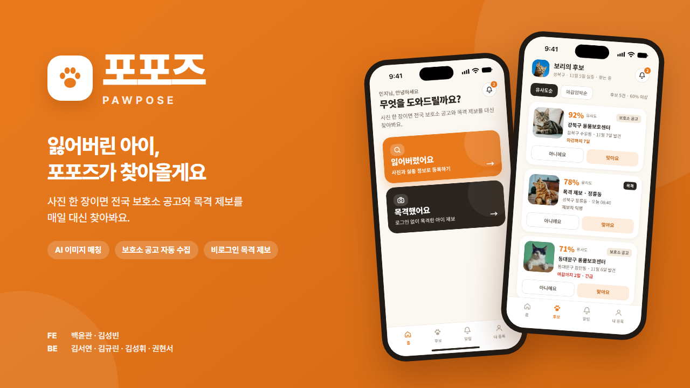
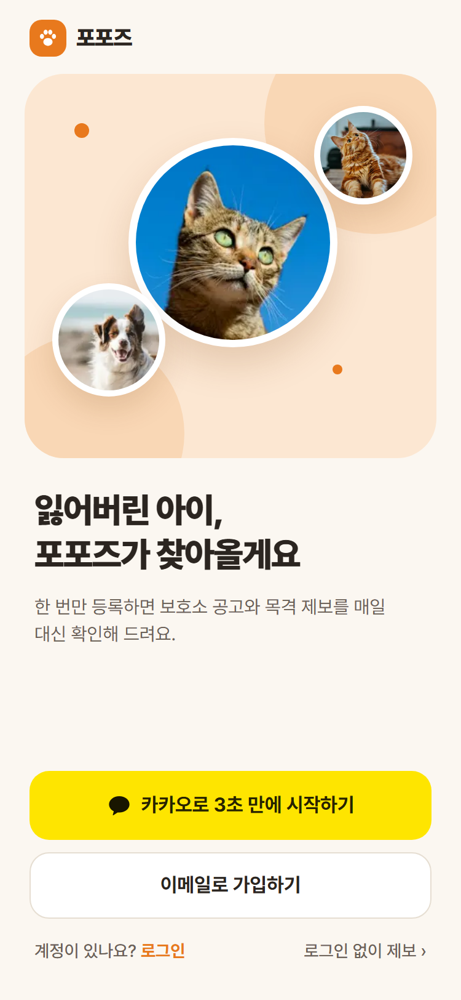
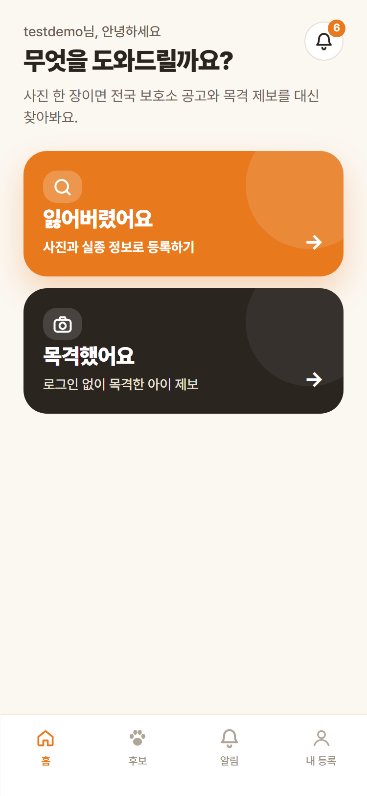
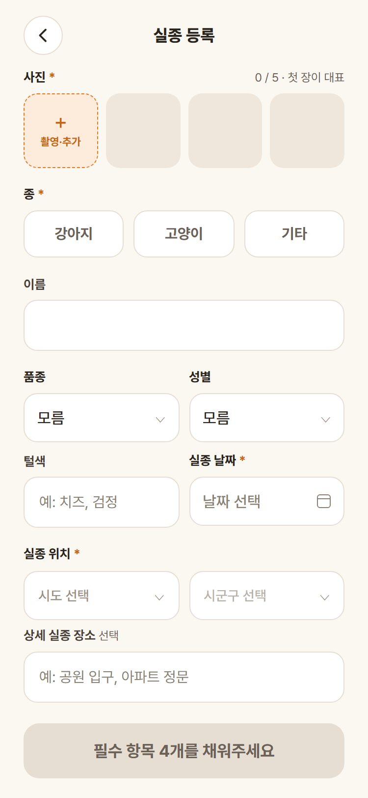
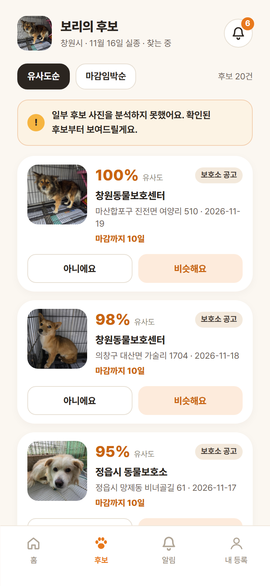
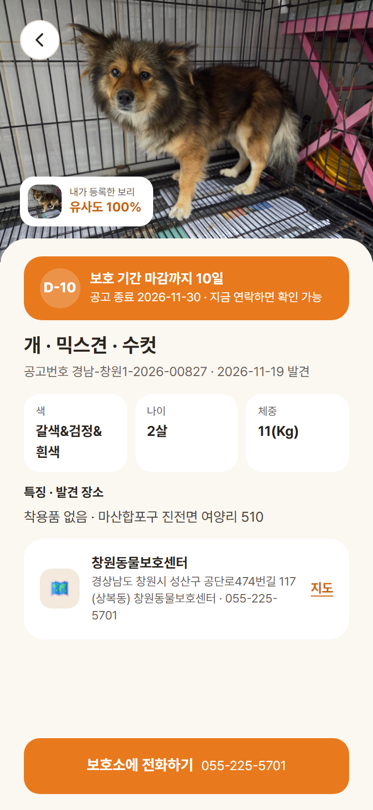
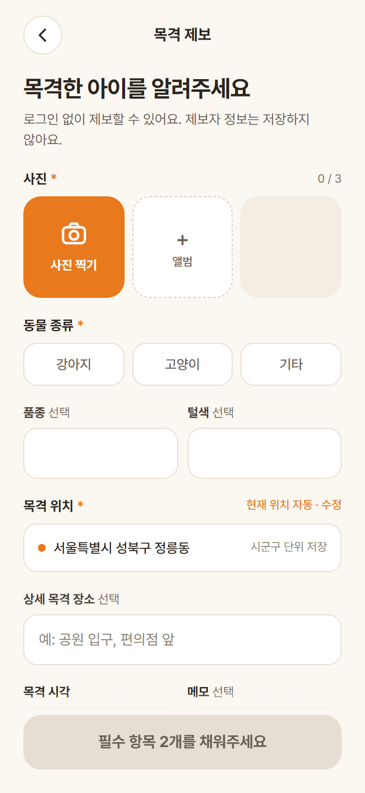
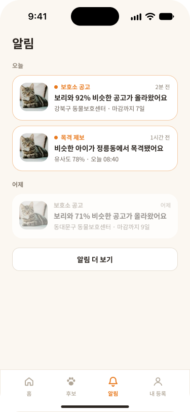
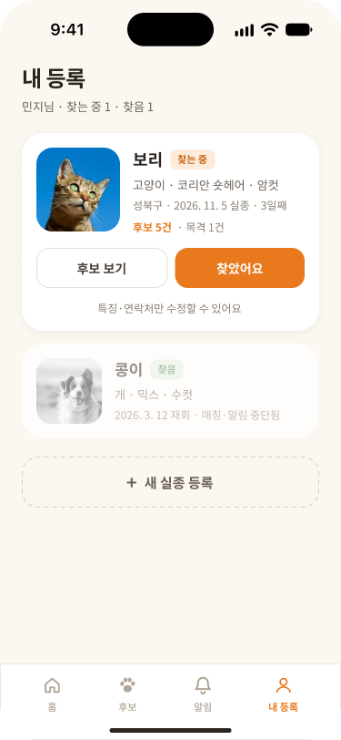

# 🐾 포포즈 (PAWPOSE)

> 사진 한 장으로 전국 보호소 공고와 목격 제보를 매일 대신 찾아주는 실종 반려동물 찾기 서비스입니다.

## 🚀 Deployment

> 🌐 포포즈를 직접 만나보세요! [포포즈 바로가기 →](https://findpawpose.site)
>
> 🔑 데모 계정 `demo@pawpose.com` / `password1234`

## 💡 서비스 소개

**포포즈**는 반려동물을 잃어버린 보호자가 **매일 보호소 공고를 직접 뒤지지 않아도 되도록** 돕는 서비스입니다.

반려동물을 잃어버리면 보호자는 국가동물보호정보시스템의 공고를 하루에도 몇 번씩 확인해야 합니다. 공고는 지역마다 흩어져 있고, 보호 기간이 지나면 입양이나 안락사로 이어질 수 있어 시간이 가장 중요합니다.

포포즈는 실종 반려동물의 **사진 한 장**만 등록하면 **전국 보호소 공고를 자동으로 수집**하고, **AI 이미지 매칭**으로 비슷한 아이를 **유사도 순**으로 보여줍니다. 길에서 비슷한 아이를 본 사람은 **로그인 없이 목격 제보**를 남길 수 있고, 새 후보가 생기면 보호자에게 **알림**으로 알려드립니다.

> **찾는 일은 포포즈가, 보호자는 확인만!** 남은 보호 기간과 보호소 연락처까지 한 화면에서 확인할 수 있습니다.

## ✨ 주요 기능

### 01. 사진 한 장으로 실종 등록

카카오 또는 이메일로 로그인한 뒤, 실종 반려동물의 **사진(최대 5장)과 종 · 실종 날짜 · 실종 위치**를 등록합니다. 등록과 동시에 사진을 분석해 보호소 공고와 **바로 비교**를 시작합니다.

<p>
  
  
  
</p>

### 02. AI 이미지 매칭 · 후보 목록

공공 API에서 **30분마다 보호소 공고를 수집**하고, 실종 사진과 공고 사진을 **이미지 임베딩(SigLIP)으로 비교**해 비슷한 순으로 **상위 20건**을 보여줍니다. **유사도순 · 마감임박순**으로 정렬할 수 있고, 후보마다 **비슷해요 / 아니에요**를 남겨 목록을 정리할 수 있습니다.

<p>
  
</p>

### 03. 공고 상세 · 마감 카운트다운

후보를 누르면 공고 사진과 특징, **보호 기간 마감까지 남은 날짜(D-N)**, 보호소 주소와 지도를 보여줍니다. 하단의 **보호소에 전화하기** 버튼으로 바로 연락할 수 있습니다.

<p>
  
</p>

### 04. 로그인 없는 목격 제보

길에서 비슷한 아이를 본 사람은 **로그인 없이** 사진과 위치만 남기면 됩니다. 현재 위치는 **시군구 단위로 자동 입력**되고, 제보자 정보는 저장하지 않습니다. 제보 사진은 등록된 실종 반려동물과 **바로 비교**되어 비슷한 아이의 보호자에게 전달됩니다.

<p>
  
</p>

### 05. 새 후보 알림 · 내 등록 관리

새 공고 후보나 목격 제보가 생기면 **앱 내 알림과 종 아이콘 뱃지**로 알려드립니다. 내 등록 화면에서는 반려동물별 **찾는 중 / 찾음** 상태와 후보 수를 확인하고, 아이를 찾으면 **찾았어요**로 매칭과 알림을 멈출 수 있습니다.

<p>
  
  
</p>

## 🛠️ 기술 스택

| 구분 | 기술 |
| :---: | --- |
| **Frontend** | React 19, JavaScript (ES6+), Vite 8, CSS Modules |
| **Routing** | React Router DOM 7 |
| **API** | Fetch API, REST API |
| **Backend** | Java 17, Spring Boot 3.5, Spring Security, Spring Data JPA, Bean Validation, JWT |
| **Database** | PostgreSQL 16 (배포), H2 (로컬 개발) |
| **Image Matching** | Python, PyTorch, Transformers, SigLIP (google/siglip-base-patch16-224) |
| **Cloud & Infrastructure** | AWS EC2, AWS S3, Docker, Docker Compose, Nginx, Vercel |
| **CI/CD** | GitHub Actions, Docker Hub |
| **External Service** | 국가동물보호정보시스템 공공 API, Kakao Login, Kakao Local API |
| **API Documentation** | OpenAPI, Swagger UI, springdoc-openapi |
| **Collaboration** | GitHub, Figma, Notion, Discord |

## 📁 프로젝트 구조

```
src
├─ apis         백엔드 API 호출
├─ assets       아이콘 · 이미지
├─ components   공통 · 화면 단위 컴포넌트
├─ constants    상수 · 문구
├─ hooks        화면 로직 훅
├─ layouts      하단 탭 레이아웃
├─ pages        라우트별 화면
├─ routes       라우트 · 로그인 가드
├─ styles       디자인 토큰 · 전역 스타일
└─ utils        날짜 · 이미지 등 유틸
```

## ⚙️ 실행 방법

```sh
npm ci
cp .env.example .env
npm run dev
```

| 환경 변수 | 설명 |
| --- | --- |
| `VITE_API_BASE_URL` | 백엔드 API 주소 (`https://api.findpawpose.site`) |
| `VITE_KAKAO_REST_API_KEY` | 카카오 REST API 키 |

## 📜 오픈소스 · 데이터 출처

| 이름 | 용도 | 라이선스 |
| --- | --- | --- |
| [React](https://github.com/facebook/react) | UI 라이브러리 | MIT |
| [React Router](https://github.com/remix-run/react-router) | 라우팅 | MIT |
| [React DayPicker](https://github.com/gpbl/react-day-picker) | 실종 날짜 선택 달력 | MIT |
| [react-zoom-pan-pinch](https://github.com/BetterTyped/react-zoom-pan-pinch) | 사진 확대 보기 | MIT |
| [Vite](https://github.com/vitejs/vite) | 빌드 도구 | MIT |
| [Pretendard](https://github.com/orioncactus/pretendard) | 폰트 | SIL OFL 1.1 |
| [SigLIP](https://huggingface.co/google/siglip-base-patch16-224) | 이미지 임베딩 모델 | Apache-2.0 |
| [국가동물보호정보시스템](https://www.animal.go.kr) 구조동물 조회 API | 보호소 공고 · 사진 | 공공데이터포털 이용약관 |
| [Kakao Developers](https://developers.kakao.com) | 카카오 로그인 · 좌표→행정구역 변환 | Kakao 이용약관 |

- 시작 화면 반려동물 사진
  - 고양이(가운데): [Unsplash](https://images.unsplash.com/photo-1574158622682-e40e69881006) · Unsplash License
  - 강아지(왼쪽): [Pauline Loroy, Unsplash](https://unsplash.com/photos/white-and-brown-long-coat-large-dog-U3aF7hgUSrk) · Unsplash License
  - 고양이(오른쪽): [Amber Kipp, Pexels](https://www.pexels.com/photo/8405873/) · Pexels License
- 아이콘: 직접 제작

## 👥 팀원

<p>
  
  
  
  
  
  
</p>

## 📂 Repository

### 💻 Frontend

> 포포즈의 사용자 인터페이스와 클라이언트 기능을 담당합니다.
>
> [Frontend Repository →](https://github.com/line4thon-team28/Frontend)

### ⚙️ Backend

> 포포즈의 REST API, 공고 수집, 이미지 매칭, 데이터 관리를 담당합니다.
>
> [Backend Repository →](https://github.com/line4thon-team28/Backend)
